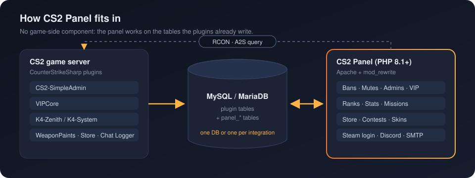
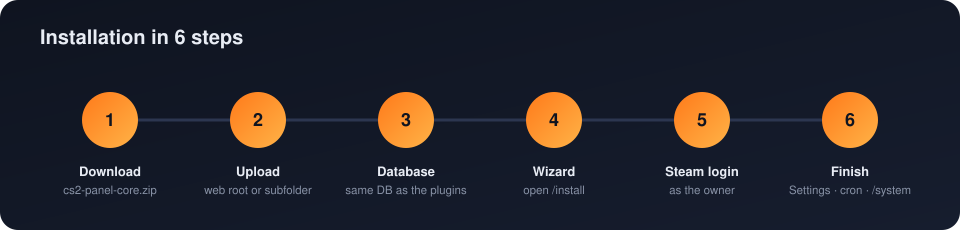
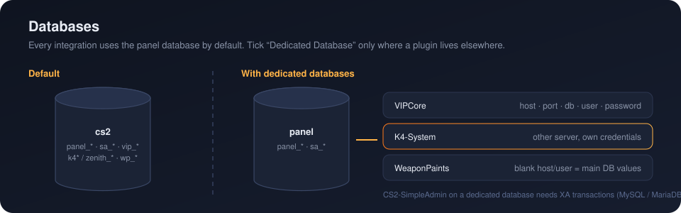
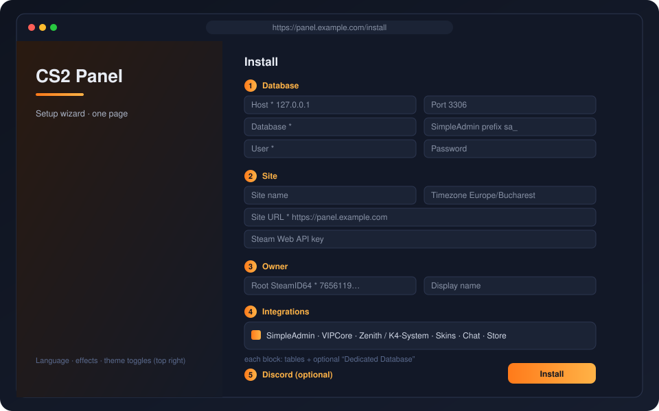

# CS2 Panel

A PHP admin and community panel for Counter-Strike 2 servers. It sits on top of the MySQL/MariaDB tables that popular CounterStrikeSharp plugins already use, so there is no separate game-side component to install. No framework and no build step for the PHP side: a small front controller, a router, plain PHP views and PDO.

Version: see [VERSION](VERSION).

Live demo: [gobans.ro/GO](https://gobans.ro/GO)

<p align="center"></p>

## Supported plugins

The panel reads and writes the plugins' own tables.

| Plugin | What the panel uses it for |
|---|---|
| CS2-SimpleAdmin (`sa_*` tables) | Bans, mutes, warns, admins, admin groups, server list |
| VIPCore | VIP users and groups (`account_id` = SteamID64 − 76561197960265728) |
| K4-Zenith | Ranks, stats, playtime (JSON columns) |
| K4-System | Ranks, stats, playtime (flat tables); optional missions, achievements and seasons |
| WeaponPaints | Skin selection per player (`wp_` prefix, configurable) |
| cs2-store (schwarper) | Store credits |

Zenith and K4-System are alternative stats backends; `StatsBackend` picks the one that is configured.

## Requirements

| Component | Minimum | Notes |
|---|---|---|
| PHP | 8.1 (8.2+ recommended) | Extensions `pdo_mysql`, `curl`, `mbstring`, `openssl`, `zip` are required; `zlib`, `gd`, `sockets` are recommended. OPcache on, `display_errors` off. |
| PHP memory | `memory_limit = 256M` | Shipped in `.user.ini` (CGI/FastCGI) and `.htaccess` (mod_php). The skins catalog refresh decodes multi-MB JSON files. |
| Database | MySQL or MariaDB (InnoDB) | Reachable from the web host. XA transactions are needed only if CS2-SimpleAdmin lives in a dedicated database. |
| Web server | Apache with `mod_rewrite` and `AllowOverride All` | Nginx works with the config shown in [Nginx](#nginx). |
| HTTPS | Recommended | Steam login, PayPal webhooks and secure cookies expect it. |
| Steam Web API key | Required for names/avatars | Get one at [steamcommunity.com/dev/apikey](https://steamcommunity.com/dev/apikey). |
| RCON | Optional | Only for the RCON console, live players and instant VIP/admin reload. |

## Installation

<p align="center"></p>

### 1. Download

Open the [latest release](https://github.com/pandathebeasty/cs2_panel/releases/latest) and download:

| Archive | Needed | Contents |
|---|---|---|
| `cs2-panel-core.zip` | Always | Code, views, assets, translations, database schema and migrations, K4-System defaults and icons. |
| `cs2-panel-maps.zip` | Recommended | Map images for the server list and live status. |
| `cs2-panel-skins.zip` | Only for the Skins page | WeaponPaints catalog data (`app/Data/weaponpaints`). |

Every archive has a single top-level folder. Extract them over each other so `app/`, `assets/`, `config/`, `database/` and `index.php` end up side by side.

### 2. Upload the files

Upload the **contents** of the extracted folder to the web root (`public_html/`, `/var/www/html/`) or to a subfolder (`public_html/panel/`).

- Include the hidden files `.htaccess` and `.user.ini`. Many FTP clients hide them by default.
- **Subfolder install:** edit `.htaccess` and set `RewriteBase /panel/` (the folder path, with both slashes). Links inside the panel follow the base path automatically.
- The `.htaccess` blocks web access to `app/`, `config/`, `database/`, `db_backups/`, `storage/` and `tools/`. Keep it.

The web server user must be able to write to:

| Path | Why |
|---|---|
| `config/` | The wizard writes `config/config.php`; settings changes keep it in sync. |
| `db_backups/` | Database backups and update rollback snapshots. |
| `storage/` | Runtime cache. |
| `assets/img/uploads/` | Logo, favicon and images uploaded from Settings. |
| `assets/css/themes/personal/` | Personal themes installed from Settings. |
| `app/Data/` | Skins catalog and rarity colours refreshed by maintenance. |
| Panel root (recommended) | The self-updater overwrites `app/`, `assets/` and `database/`. |

On Linux a typical setup is:

```bash
cd /var/www/html/panel
chown -R www-data:www-data .
find . -type d -exec chmod 755 {} \;
find . -type f -exec chmod 644 {} \;
```

### 3. Prepare the database

<p align="center"></p>

The panel reads the tables the plugins create themselves; it never creates or alters plugin tables. Its own tables all start with `panel_`.

The simplest setup is to point the panel at **the same database the plugins use**. If you want a new database and user:

```sql
CREATE DATABASE cs2 CHARACTER SET utf8mb4 COLLATE utf8mb4_unicode_ci;
CREATE USER 'cs2panel'@'%' IDENTIFIED BY 'a-strong-password';
GRANT ALL PRIVILEGES ON cs2.* TO 'cs2panel'@'%';
FLUSH PRIVILEGES;
```

- Replace `'%'` with the web host IP when the database is on another machine, and make sure the MySQL port (3306) is open for it.
- If a plugin writes to another database or server, keep the panel database as the main one and enable **Dedicated Database** for that integration in step 4.
- When CS2-SimpleAdmin uses a dedicated database, both servers must support XA transactions (InnoDB, the default). The wizard checks this.

### 4. Run the setup wizard

Open `https://your-domain/install` (or `/panel/install`). The wizard is a single page; the language, theme and effects switches are in the top right.

<p align="center"></p>

**Database**

| Field | Default | Notes |
|---|---|---|
| Host * | `127.0.0.1` | Use the database server address when it is not local. |
| Port | `3306` | |
| Database * | | Main database (panel tables are created here). |
| SimpleAdmin prefix | `sa_` | Prefix of the CS2-SimpleAdmin tables. |
| User * / Password | | Credentials from step 3. |

**Site**

| Field | Default | Notes |
|---|---|---|
| Site name | `CS2 Panel` | Shown in the header, emails and Discord messages. |
| Timezone | `UTC` | A PHP timezone, e.g. `Europe/Bucharest`. |
| Site URL * | Detected | Full public URL without a trailing slash, e.g. `https://panel.example.com` or `https://example.com/panel`. Steam login returns to `<Site URL>/auth/steam/return`, so it must be exact. |
| Steam Web API key | | Needed for player names and avatars. |

**Owner**

| Field | Default | Notes |
|---|---|---|
| Root SteamID64 * | | Your 17-digit SteamID64 (`7656119…`), found on [steamid.io](https://steamid.io). This account becomes the panel owner. |
| Display name | `Root` | |
| Super admins | | Optional comma-separated SteamID64 list with full access, stored in `config.php`. |

**Integrations**

Each block matches one plugin. Leave table names at their defaults unless you changed them in the plugin config.

| Integration | Options |
|---|---|
| CS2-SimpleAdmin | Always on. Optional dedicated database. |
| VIPCore | Enable switch, VIP groups (one per line, can be edited later), optional dedicated database. |
| Ranks & stats | Enable switch and plugin choice: **K4-Zenith** (ranks, stats, storage table, SteamID column) or **K4-System** (table prefix, ranks/stats/times tables, SteamID column, Competitive or Premier rank style). Optional dedicated database for the selected plugin. |
| WeaponPaints (Skins) | Enable switch, table prefix (`wp_`), optional dedicated database. |
| Chat Logger | Optional dedicated database. |
| Store Credits | Optional dedicated database. |

**Dedicated Database:** tick it only for an integration whose tables are not in the main database. Host, port and user may be left blank to reuse the main values; the password is reused when the user is the same. Each dedicated database is tested before anything is written.

**Discord:** an optional webhook URL. It receives a "Panel Installed" message and later the moderation notifications.

When you press **Install** the wizard:

1. checks the required fields and the SteamID64;
2. tests the main connection and every dedicated database;
3. creates the `panel_*` tables from `database/panel_schema.sql` and applies every migration in `database/migrations/`;
4. creates the owner account;
5. stores all default settings in `panel_settings`;
6. writes `config/config.php`;
7. sends the Discord message and redirects to the login page.

Any error is shown at the top of the form and the values you typed are kept. If `panel_settings` already exists (reinstalling on an existing database), your previous settings are kept; only the database choices made in the wizard are overwritten.

### 5. Sign in

Click **Sign in with Steam** with the account whose SteamID64 you entered. Once `config/config.php` exists, `/install` redirects to the panel; to run the wizard again, delete that file.

### 6. After installation

- **Settings → General → Cron:** add the shown line to the host crontab (every minute). Without it, maintenance runs lazily on page loads, at most once a minute.

  ```bash
  * * * * * curl -s "https://panel.example.com/cron?token=YOUR_TOKEN" >/dev/null 2>&1
  ```

- **Settings → Integrations:** review the plugins, VIP groups, ranks backend and, for K4-System, the optional Missions, Achievements and Seasons pages (upload the server's `missions.jsonc` / `achievements.jsonc` if you changed them).
- **Servers:** add the game servers with their RCON password for live status and instant reloads.
- **Settings → Discord:** webhooks per category. **Settings → Store:** SMTP for order and alert emails.
- **Store:** set the PayPal credentials and point the PayPal webhook to `https://panel.example.com/store/webhook`.
- **System (`/system`):** checks PHP, extensions, memory, writable folders, migrations, HTTPS, cron and 2FA. Fix anything marked red.
- **Account → Security:** enable two-factor authentication for the owner account.

### Manual installation (without the wizard)

1. Copy `config/config.example.php` to `config/config.php` and fill in `db`, `steam`, `super_admins` and `app`.
2. Import `database/panel_schema.sql` into the main database. Pending migrations are applied automatically on the first request.
3. Add your account as owner:

   ```sql
   INSERT INTO panel_users (steamid64, name, role, can_manage) VALUES ('7656119XXXXXXXXXX', 'Owner', 'owner', 1);
   ```

4. Open the panel and sign in with Steam. Every other option is in Settings.

### Nginx

```nginx
server {
    listen 443 ssl http2;
    server_name panel.example.com;
    root /var/www/html/panel;
    index index.php;

    location ~ ^/(app|config|database|db_backups|storage|tools)(/|$) { deny all; }
    location ~ /\.(?!well-known) { deny all; }
    location ~ \.(env|ini|log|sql|md)$ { deny all; }

    location / { try_files $uri $uri/ /index.php?$query_string; }

    location ~ \.php$ {
        include fastcgi_params;
        fastcgi_param SCRIPT_FILENAME $document_root$fastcgi_script_name;
        fastcgi_pass unix:/run/php/php8.2-fpm.sock;
        fastcgi_read_timeout 300;
    }
}
```

Set `memory_limit = 256M` and `max_execution_time = 300` in the PHP-FPM pool, because Nginx ignores `.htaccess` and `.user.ini` is read only by PHP.

### Updating

- **From the panel:** Settings → Updates or `/update` (owner only). The panel checks GitHub releases at most every 6 hours, takes a code snapshot for rollback, then applies the update in small steps so it works within shared hosting time limits.
- **Kept on update:** `config/config.php`, `db_backups/`, uploads, personal themes and settings stored in the database. New settings are added with their defaults, `config/config.php` is synced automatically, and new migrations run on the next request.
- **Manual update:** upload the new `cs2-panel-core.zip` contents over the existing files, without deleting `config/`, `db_backups/` or `assets/img/uploads/`.

### Troubleshooting

| Symptom | Fix |
|---|---|
| Every page except the home page returns 404 | Enable `mod_rewrite`, set `AllowOverride All`, check that `.htaccess` was uploaded and that `RewriteBase` matches the subfolder. |
| Steam login returns to the wrong address or fails | The Site URL must match the public URL exactly (scheme, domain, subfolder, no trailing slash). Change it in Settings → General. |
| `Allowed memory size exhausted` | Raise `memory_limit` to 256M. `.user.ini` changes can take up to 5 minutes to apply. |
| `Could not write config/config.php` | Make `config/` writable by the web server user. |
| Dedicated database "XA required" error | Use InnoDB on both servers, or keep CS2-SimpleAdmin in the main database. |
| Ranks, VIP or skins pages are missing | Enable the integration in Settings → Integrations and check the table names and prefix. |
| Map images are missing | Upload `cs2-panel-maps.zip`. |
| Anything else | Open `/system` and `/health` (owner only); errors are also written to `error.log`. |

### Configuration keys (`config/config.php`)

`db`, `sa_prefix`, `stats`, `zenith`, `k4system`, `vipcore`, `weaponpaints`, `chat_logger`, `integration_db`, `steam` (`api_key`, `realm`, `return_url`), `super_admins`, `app`, `rcon` (timeout, reload commands), `query`. Everything else (Discord, SMTP, PayPal, store, themes, notification toggles) is stored in the database and edited from the Settings page. Values changed in Settings are written back to `config/config.php` automatically.

### Settings reference

Every option on the Settings page, with its default value and what it does, is documented in **[docs/SETTINGS.md](docs/SETTINGS.md)**, including a quick table of what is enabled by default.

## Features

**Moderation**
- Bans, mutes and warns: create, edit, expire/unban, delete, bulk update, bulk delete.
- Details popup per sanction, including the unban history. Unbanned entries no longer show as permanent.
- Ban appeals and player reports, with resolve and delete.
- Admins and admin groups, with a canonical flag list (custom flags are allowed and preserved).
- Panel users with roles: guest, user, admin, owner, root. Super admins come from the config.

**Servers**
- Server list with live A2S status (map, players/max players).
- RCON console per server, with a live player list and player actions.
- After a VIP or admin change, `ServerSync` sends the configured reload commands over RCON so players don't need to reconnect. Failures are logged and never roll back the change.

**VIP and contests**
- VIP add, extend, update and remove, with a pending queue: a prize of a different group waits until the current VIP lapses.
- Contests on rank or playtime, scheduled or manual. Winners are drawn from the stats leaderboard, paged 50 rows at a time. Players who can't use the prize are skipped and the next one is taken (permanent VIP when extending is on, any active VIP when it is off; credits-only contests skip nobody).
- Prize types: VIP and store credits. Grant per winner or all, redraw, resend, delete.
- Creating a contest can back up the database and reset ranks first. The backup is a plain `.sql` dump written with PDO only, to `db_backups/`, so it works on shared hosting.
- Discord announcement when a contest starts and ends.

**Stats**
- Ranks, stats and playtime for Zenith and K4-System: list, search, edit points/stats/playtime, reset one or all.
- K4-System player progress (optional, per page): daily/weekly missions with streaks, achievements with rarity, seasons with podium and history. Uses the plugin's `missions.jsonc` / `achievements.jsonc` (bundled defaults or uploaded in Settings) and its translations.
- Credits: set, add, subtract, reset.
- Skins page (WeaponPaints) with rarity colours generated from the ByMykel CSGO-API (`tools/gen_rarity_colors.php`, also refreshed by the maintenance tick).
- Benefits page with SVG icons per VIP group, including premium variants and Supreme.

**Store**
- Packages (VIP, admin perks, credits), cart, discount codes, optional donations.
- PayPal checkout with webhook, sandbox/live credentials, optional fee passed to the buyer.
- Orders: refund, re-grant, plus test-mode tools (mark paid, test email, test Discord).
- Admin perks granted by the store are revoked automatically when their duration ends; stale pending orders are auto-cancelled.

**Notifications**
- Discord webhooks, with a per-category toggle (bans, mutes, warns, appeals, reports, VIP, admins, groups, resets, …).
- SMTP mail (host, port, user, password, ssl/tls, from) for order emails and alerts, with a test button. Without SMTP configured the mailer falls back to PHP mail.

**Other**
- Steam OpenID login, guest mode, personal profile card and rank.
- Chat log viewer, action log and error log.
- Health page (`/health`, owner only): DB reachability, expected tables and columns, applied migrations, latest errors. It renders without the main layout so it still works when the layout is what's broken.
- Self-updater based on GitHub tags (checked at most every 6 hours, cached), applied in steps from `/update`.
- Languages: English, Romanian, German, Russian (`app/Lang`).
